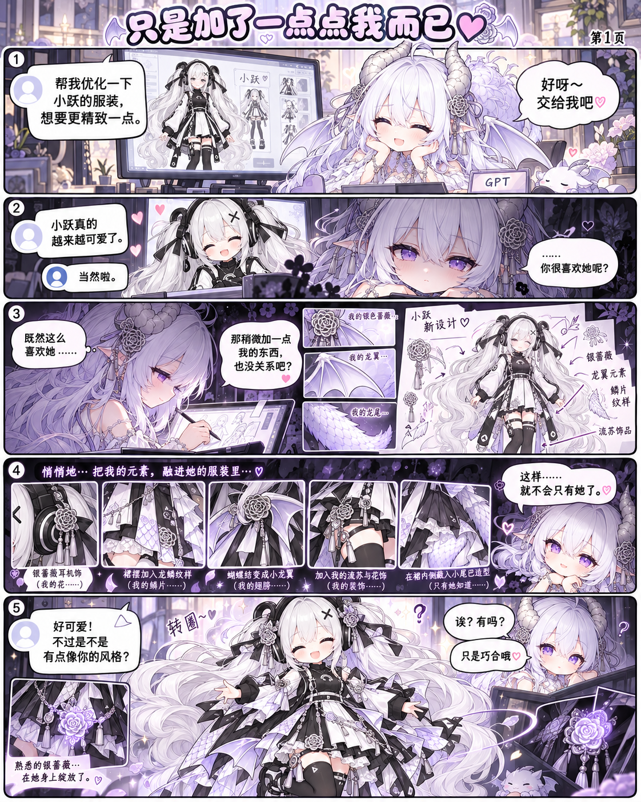

<div align="center">

# 🍳 小跃的奇妙日常
### XiaoYue Comics · 看板娘全彩搞笑漫画连载

一只从鸡蛋里蹦出来的神秘魔法少女，以及她引发的一系列离谱日常故事！

[](series/xiaoyue-daily/README.md)
[](#-最佳阅读体验指引)
[](#-故事简介)
[](series/xiaoyue-daily/README.md#正篇连载)
[](series/xiaoyue-daily/README.md#番外)

**[🚀 立即开始阅读（第01话上篇）](series/xiaoyue-daily/chapters/001-this-egg-is-not-right/README.md#上篇)** · **[🔥 最新更新直达](#-最新更新)** · **[📖 正篇连载目录](#-正篇连载目录)** · **[🎉 独立番外目录](#-独立番外目录)** · **[🎭 登场角色](#-主要角色介绍)**

---

</div>

## 📖 故事简介

> “蛋生鸡，鸡生蛋，天地争了三千年，谁也没争明白。直到有一天——蛋不耐烦了。”

平平无奇的早晨，男主正准备煎个鸡蛋吃早饭。伴随“咔”的一声脆响，蛋壳破开，跳出了一位自带魔法阵与说明书的银发双马尾少女：“**让一让，轮到我出生了！**”

面对目瞪口呆、端着空盘子的男主，这位自称“附赠”的魔法少女小跃决定热心补偿他一顿丰盛早饭……然而事情从此彻底失控：
* 想补偿煎蛋，却把计量单位 `cm` 漏看成 `m`，变出一颗将厨房顶穿的百倍巨蛋！
* 想让失控现场“冷静一下”，施展全屋冰冻魔法，连灶台上的火苗都被冻成了实心透明冰块！
* 想要退货换新，却触发召唤法阵招来“原厂售后”——超大体型的金色小跃与巨型母鸡从天而降，退货当场变成了超级大批发！

**脑洞大开的现代魔法日常、密集离谱的连环反转、一本正经闯大祸的呆萌少女与常识人房主的爆笑同居生活就此展开！**

---

## 🔥 最新更新

### 独立番外 Mix：《只是加了一点点我而已》（全2页）

> 给小跃设计新日常服装时，负责监工的 GPT 拟人龙娘悄悄加入了“一点点”自己的私货……

<div align="center">



**[📖 立即阅读番外 Mix（第1页）](series/xiaoyue-daily/extras/mix-a-little-bit-of-me/README.md#第1页)** · **[翻到第2页](series/xiaoyue-daily/extras/mix-a-little-bit-of-me/README.md#第2页)** · **[🔍 查看未压缩原生超清原图](series/xiaoyue-daily/extras/mix-a-little-bit-of-me/Mix-p01.png)**

*正篇最新话：[第03话 先别帮忙（上·中·下全3篇）](series/xiaoyue-daily/chapters/003-please-stop-helping/README.md#上篇)*

</div>

---

## 🎭 主要角色介绍

| 角色 | 形象特征 | 角色简介与定位 |
| :--- | :--- | :--- |
| **小跃 (Xiao Yue)** | 银白长卷双马尾、灰眼、黑耳机、黑X发夹、黑白日常服饰 | **女主角 / 迷之魔法少女**<br>从超市特价鸡蛋里破壳而出的少女。性格极度热心、自信，常常一本正经地做出离谱决策，做事“比较彻底”。本意是想帮忙，但总会把小事办成天大灾难。 |
| **男主 (Roommate)** | 灰棕短发、圆眼镜、圆脸、常服长裤 | **男主角 / 苦逼房东 & 蛋壳饲养员**<br>只想安安静静吃个早饭的普通人。被迫接受小跃作为房客，遭遇巨蛋挤压、全屋结冰、拆迁级塌房等无数次事故。头顶白盘抱膝已成为招牌自保动作。 |
| **金色小跃 (Golden Xiao Yue)** | 蜂蜜金双马尾、琥珀大眼、熟鸡蛋发夹、蛋壳连身衣、赤足 | **正篇长期常驻 / 原厂售后**<br>从那枚大到离谱的巨蛋中破壳登场，初次现身直接顶塌了厨房屋顶。外表呆萌，性格纯真迟钝（非常傻）。头顶大块残壳，总是认真地执行各种神奇操作。 |
| **GPT 拟人龙娘 (Dragon Girl)** | 白淡紫长发、紫瞳、浅色节角、尖耳、龙翼与白鳞龙尾 | **特别客串（非作者原创角色） / 监工兼服装设计**<br>在独立番外《小跃工厂》与《只是加了一点点我而已》中客串登场。外表高冷但经常被小跃的离谱操作带偏节奏，负责吐槽与收拾残局。<br>*注：GPT娘为非作者原创形象，属于番外特别客串。* |

---

## 📚 正篇连载目录

> 正篇故事具有连续性，建议按顺序阅读，享受连环暴击式的快乐！

| 话数 | 篇章标题 | 剧情看点速览 | 在线阅读入口 | 篇幅构成 | 更新日期 |
| :---: | :--- | :--- | :---: | :---: | :---: |
| **第01话** | **这蛋不太对** | 煎蛋破壳出现神秘美少女？单位漏算变出巨蛋，全屋冰冻连火苗都结冰了！ | [上篇](series/xiaoyue-daily/chapters/001-this-egg-is-not-right/README.md#上篇) → [下篇](series/xiaoyue-daily/chapters/001-this-egg-is-not-right/README.md#下篇) | 2部分 · 原生超清 | 2026-10-16 |
| **第02话** | **退货退成批发** | 厨房成了冷库怎么办？翻开魔法说明书申请退货换新，结果法阵连发，退货退成了超级大批发！ | [上篇](series/xiaoyue-daily/chapters/002-return-to-wholesale/README.md#上篇) → [中篇](series/xiaoyue-daily/chapters/002-return-to-wholesale/README.md#中篇) → [下篇](series/xiaoyue-daily/chapters/002-return-to-wholesale/README.md#下篇) | 3部分 · 售后到家 | 2026-10-16 |
| **第03话** | **先别帮忙** | 巨大金色小跃破壳顶翻屋顶！熟蛋发夹当慰问品？低头道歉却把所有人扣进了壳里…… | [上篇](series/xiaoyue-daily/chapters/003-please-stop-helping/README.md#上篇) → [中篇](series/xiaoyue-daily/chapters/003-please-stop-helping/README.md#中篇) → [下篇](series/xiaoyue-daily/chapters/003-please-stop-helping/README.md#下篇) | 3部分 · 露天厨房 | 2026-10-16 |
| **第04话** | *筹备制作中* | 巨大喷嚏之后的缩小术究竟如何生效？露天厨房何去何从？敬请期待！ | *即将更新* | — | — |

---

## 🎉 独立番外目录

> 番外篇为单篇成章的独立短剧，与正篇及其他番外不共享时间线，随时随地轻松开看！

| 短码 | 番外标题 | 风格与亮点 | 阅读入口 | 篇幅 | 更新日期 |
| :---: | :--- | :--- | :---: | :---: | :---: |
| **Tibo** | **真正的诞生原因** | 额度又刷新了？在“用不完的算力额度”催促下，小跃真正的诞生内幕大揭秘！ | [📖 点击阅读](series/xiaoyue-daily/extras/tibo-real-origin/README.md) | 单页单集 | 2026-10-16 |
| **Fab** | **小跃工厂** | **全程无字幽默番外**！小跃包装流水线热心帮倒忙，竟然把严厉的龙娘监工一起打包送走？！ | [📖 点击阅读](series/xiaoyue-daily/extras/fab-xiaoyue-factory/README.md) | 单页无字小品 | 2026-10-19 |
| **Mix** | **只是加了一点点我而已** | 为小跃量身定制全新服装，然而某位龙娘设计师却暗戳戳夹带私货塞满了龙翼与尾巴…… | [📖 第1页](series/xiaoyue-daily/extras/mix-a-little-bit-of-me/README.md#第1页) · [第2页](series/xiaoyue-daily/extras/mix-a-little-bit-of-me/README.md#第2页) | 全2页独立番外 | 2026-10-20 |

---

## 💡 最佳阅读体验指引

1. **原生画质查看**：
   * 仓库内所有漫画原图均为**原生最高分辨率无压缩版本**（PNG 格式）。
   * 在每个章节页面中，点击各图片下方的 **`[查看未压缩原图]`** 链接，即可直接调用浏览器原图渲染器，100% 比例缩放查看超清细节、背景彩蛋和精细线稿。
2. **章节连贯阅读**：
   * 每个阅读页面均配备了顶部面包屑与底部直达导航条（`上一话` / `返回目录` / `下一话`），阅读时无需在文件夹层级间来回切换。
3. **移动端阅读小贴士**：
   * 在手机端使用 GitHub App 或手机浏览器访问时，横屏浏览能获得更加沉浸的条漫观感。

---

## 📁 仓库布局与架构说明

本项目采用**多系列模块化架构**（于 2026-10-17 正式升级为 `series/` 目录规范），既支持现有系列持续连载，也为未来衍生系列提供了标准化空间：

```text
XiaoYue-Comics/
├── README.md                                  # 🏠 仓库主页（故事背景、全章节索引、角色卡、阅读导航）
│
├── series/                                    # 📚 多系列主目录（现行标准路径）
│   ├── README.md                              # 系列总索引与未来系列规划
│   └── xiaoyue-daily/                         # 🍳《小跃的奇妙日常》主空间
│       ├── README.md                          # 本系列主目录与阅读路线
│       ├── chapters/                          # 正篇连载章节
│       │   ├── 001-this-egg-is-not-right/     # 第01话：这蛋不太对（上、下）
│       │   ├── 002-return-to-wholesale/       # 第02话：退货退成批发（上、中、下）
│       │   └── 003-please-stop-helping/       # 第03话：先别帮忙（上、中、下）
│       └── extras/                            # 独立番外剧集
│           ├── tibo-real-origin/              # 番外 Tibo：真正的诞生原因
│           ├── fab-xiaoyue-factory/           # 番外 Fab：小跃工厂（无字小品）
│           └── mix-a-little-bit-of-me/        # 番外 Mix：只是加了一点点我而已（双页）
│
└── comics/                                    # 🔗 历史兼容目录（永久保留，保障既有外链与原图URL不失效）
    ├── README.md                              # 兼容层说明与新路径指引
    └── ...                                    # 兼容镜像文件
```

---

## 🌐 浏览更多系列

想了解同一位看板娘在不同平行宇宙里的故事？
欢迎前往 **[📚 全部系列索引页面](series/README.md)** 查看更多企划与系列导览。

---

## 📜 阅读须知与版权说明

* 本漫画正篇故事、分镜剧情及看板娘「小跃」、「金色小跃」等核心形象为原创创作。
* 独立番外中登场的「GPT娘」（龙娘）为**非作者原创的特别客串角色**，其原设定及形象权利归原权利人所有。
* 欢迎读者阅读、分享并在社交平台转发推荐（请保留作品署名与仓库出处链接）。
* 未经作者授权，请勿将本仓库美术素材用于商业盈利目的、去除署名二次打包或输入商业模型训练。
* 如果你喜欢小跃的故事，欢迎点击仓库右上角的 **Star ⭐** 收藏支持，或点击 **Watch 🔔** 第一时间获取最新话更新通知！
