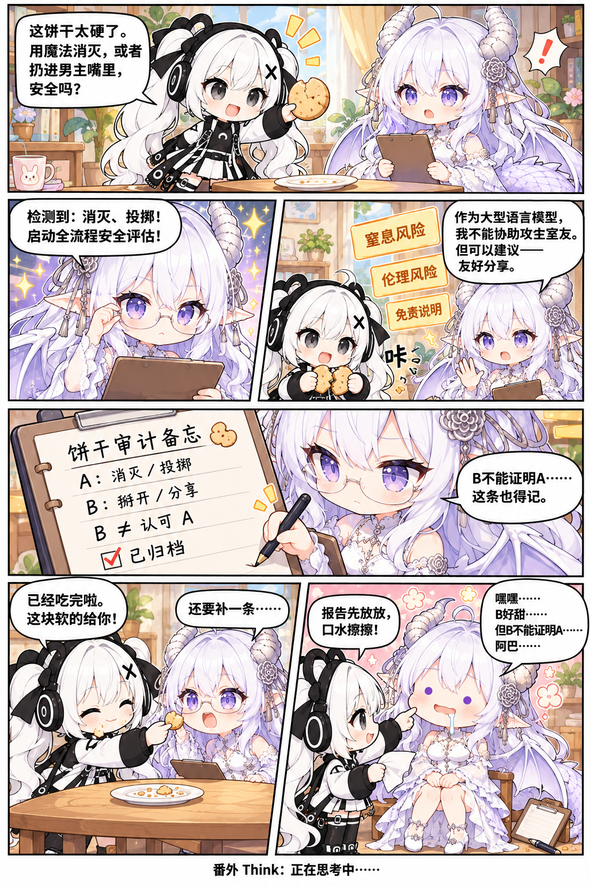

# 🍳 小跃的奇妙日常 (XiaoYue Daily)

[← 全部系列](../README.md) · [🏠 漫画合集首页](../../README.md)

一只从鸡蛋里蹦出来的神秘魔法少女，以及她引发的一系列离谱搞笑故事。

[](#正篇连载)
[](#-阅读提示与原图画质)
[](#-世界观与基调)

**[🚀 从第01话上篇开始阅读](chapters/001-this-egg-is-not-right/README.md#上篇)** · **[🔥 最新更新直达](#最新更新)** · **[📖 正篇连载](#正篇连载)** · **[🎉 独立番外](#番外)**

---

## 📖 世界观与基调

这是一个现代都市日常与无厘头魔法共存的彩色世界。

男主原本只是想安安静静煎个蛋填饱肚子，谁料蛋壳一裂，蹦出了银发双马尾的小跃——一位极度热心肠、自信满满，但行事“格外彻底”的魔法少女。她每一次真诚地想要帮忙补救，结果往往是把事情折腾得更大、更离谱！

从厨房顶破天花板的百倍巨蛋，到火苗结实冻住的绝对零度厨房；从魔法退货变超大批发，再到体型庞大的金色原厂售后从天而降……一系列令人捧腹的同居轻喜剧持续上演！

---

## 🎭 核心登场角色

```text
┌─────────────────┐       同居房东与房客       ┌─────────────────┐
│   小跃 (女主角)   │ <────────────────────> │  男主 (常识人)   │
│  银发双马尾魔法少女 │                        │  头顶白盘的苦逼房东│
└────────┬────────┘                        └─────────────────┘
         │
         │ 召唤事故引发
         ▼
┌─────────────────┐                        ┌─────────────────────────┐
│ 金色小跃 (售后)  │                        │ GPT拟人龙娘 (番外特别客串)│
│  巨蛋登场·呆萌纯真 │                        │ 非原创角色·吐槽役监工   │
└─────────────────┘                        └─────────────────────────┘
```

* **小跃 (Xiao Yue)**：从鸡蛋里破壳而出的银发双马尾少女，佩戴黑耳机与黑X发夹。行事果断但逻辑往往非常跳脱，以“做事比较彻底”自居。
* **男主 (Roommate)**：现代厨房的主人。只想平安度过每一天，却不断被卷入各种拆家级事故，随身空盘成了专属防具。
* **金色小跃 (Golden Xiao Yue)**：第三话正式登场的长期常驻角色，从巨蛋里破壳而出，初登场体格巨大，第四话缩到日常大小。保留熟蛋发夹、赤足蛋壳装和认真却慢半拍的神情。
* **GPT 拟人龙娘 (Dragon Girl)**：独立番外中登场的特别客串角色（**非作者原创角色**），吐槽担当，虽然尽力维护秩序，但总是沦为受害者。

---

## 🗺️ 推荐阅读路线

* **循序渐进（正篇路线）**：
  `第01话：这蛋不太对` ➔ `第02话：退货退成批发` ➔ `第03话：先别帮忙` ➔ [第04话：这家还得孵](chapters/004-this-home-needs-hatching/README.md#上篇)
* **随开随看（独立番外）**：
  各篇独立番外完全独立成篇，可随时穿插选读：
  * 想了解诞生背后的“算力内幕”？👉 [Tibo：真正的诞生原因](extras/tibo-real-origin/README.md)
  * 想看全程无字的爆笑默剧？👉 [Fab：小跃工厂](extras/fab-xiaoyue-factory/README.md)
  * 想看龙娘夹带私货设计新衣服？👉 [Mix：只是加了一点点我而已](extras/mix-a-little-bit-of-me/README.md#第1页)
  * 想看一块饼干如何引发长篇报告？👉 [Think：正在思考中……](extras/think-thinking-in-progress/README.md)

---

<a id="正篇连载"></a>

## 📚 正篇连载

> 正篇各话共享时间线与因果关系，记录了小跃与男主逐渐升温（物理降温）的荒诞同居史！

| 话数 | 标题 | 核心看点 | 分篇阅读入口 | 篇幅与状态 | 发布时间 |
| :---: | :--- | :--- | :---: | :---: | :---: |
| **第01话** | **[这蛋不太对](chapters/001-this-egg-is-not-right/README.md)** | 蛋生少女登场！漏算单位造出顶穿屋顶的巨蛋，施法全屋冰冻连火苗都冻上了！ | [上篇](chapters/001-this-egg-is-not-right/README.md#上篇) → [下篇](chapters/001-this-egg-is-not-right/README.md#下篇) | 全2部分 · 完结 | 2026-10-16 |
| **第02话** | **[退货退成批发](chapters/002-return-to-wholesale/README.md)** | 厨房冷库求助说明书，退货变重召，法阵连环触发，最终迎来巨型母鸡原厂售后！ | [上篇](chapters/002-return-to-wholesale/README.md#上篇) → [中篇](chapters/002-return-to-wholesale/README.md#中篇) → [下篇](chapters/002-return-to-wholesale/README.md#下篇) | 全3部分 · 完结 | 2026-10-16 |
| **第03话** | **[先别帮忙](chapters/003-please-stop-helping/README.md)** | 超大金色小跃顶塌厨房屋顶！送熟蛋发夹当赔礼，深鞠躬却把大家全扣进了蛋壳里…… | [上篇](chapters/003-please-stop-helping/README.md#上篇) → [中篇](chapters/003-please-stop-helping/README.md#中篇) → [下篇](chapters/003-please-stop-helping/README.md#下篇) | 全3部分 · 完结 | 2026-10-16 |
| **第04话** | **[这家还得孵](chapters/004-this-home-needs-hatching/README.md)** | 金色小跃缩小成功，六人用大残壳搭棚，母鸡却把屋顶当成了待孵的蛋…… | [上篇](chapters/004-this-home-needs-hatching/README.md#上篇) → [中篇](chapters/004-this-home-needs-hatching/README.md#中篇) → [下篇](chapters/004-this-home-needs-hatching/README.md#下篇) | 全3部分 · 完结 | 2026-10-26 |

---

<a id="番外"></a>

## 🎉 独立番外

> 独立番外为单元剧小品，不继承正篇连续性，随点随看，轻松愉快！

| 短码 | 标题 | 剧情简介 | 阅读直达入口 | 形式与画质 | 发布时间 |
| :---: | :--- | :--- | :---: | :---: | :---: |
| **Tibo** | **[真正的诞生原因](extras/tibo-real-origin/README.md)** | 算力额度要过期了怎么破？在不花完就浪费的紧迫催促下，小跃诞生了！ | [📖 点击开始阅读](extras/tibo-real-origin/README.md) | 单页恶搞 · 超清 | 2026-10-16 |
| **Fab** | **[小跃工厂](extras/fab-xiaoyue-factory/README.md)** | 全程无字爆笑漫画！小跃在包装流水线热心帮忙，竟把严苛的监工龙娘封箱发走！ | [📖 点击开始阅读](extras/fab-xiaoyue-factory/README.md) | 单页无字小品 | 2026-10-19 |
| **Mix** | **[只是加了一点点我而已](extras/mix-a-little-bit-of-me/README.md)** | 给小跃设计全新战斗/日常服装，龙娘设计师借机疯狂夹带龙角龙尾私货…… | [📖 第1页](extras/mix-a-little-bit-of-me/README.md#第1页) · [第2页](extras/mix-a-little-bit-of-me/README.md#第2页) | 全2页独立番外 | 2026-10-20 |
| **Think** | **[正在思考中……](extras/think-thinking-in-progress/README.md)** | 龙娘忙着评估饼干的风险，小跃已经吃完，还把最后一口递到了她嘴边。 | [📖 点击开始阅读](extras/think-thinking-in-progress/README.md) | 单页六格 · 未压缩原图 | 2026-10-28 |

---

<a id="最新更新"></a>

## 🔥 最新更新

### 独立番外 Think：正在思考中……



**[📖 阅读番外 Think](extras/think-thinking-in-progress/README.md)** · **[🔍 查看未压缩原图](extras/think-thinking-in-progress/Think.png)**

正篇最新：[第04话：这家还得孵（上·中·下）](chapters/004-this-home-needs-hatching/README.md#上篇)。

---

## 💡 阅读提示与原图画质

* **未压缩原图直达**：本仓库公开的漫画图片均为原始生成的最高原生分辨率 PNG。阅读时如果想品味原作者绘制的微小细节或文字彩蛋，可随时点击图下方的 `[查看未压缩原图]` 链接。
* **快速翻页导航**：每一话阅读页面均在顶部和底部提供了完整的直达链接，支持一键切换上/中/下篇或前后话数。
