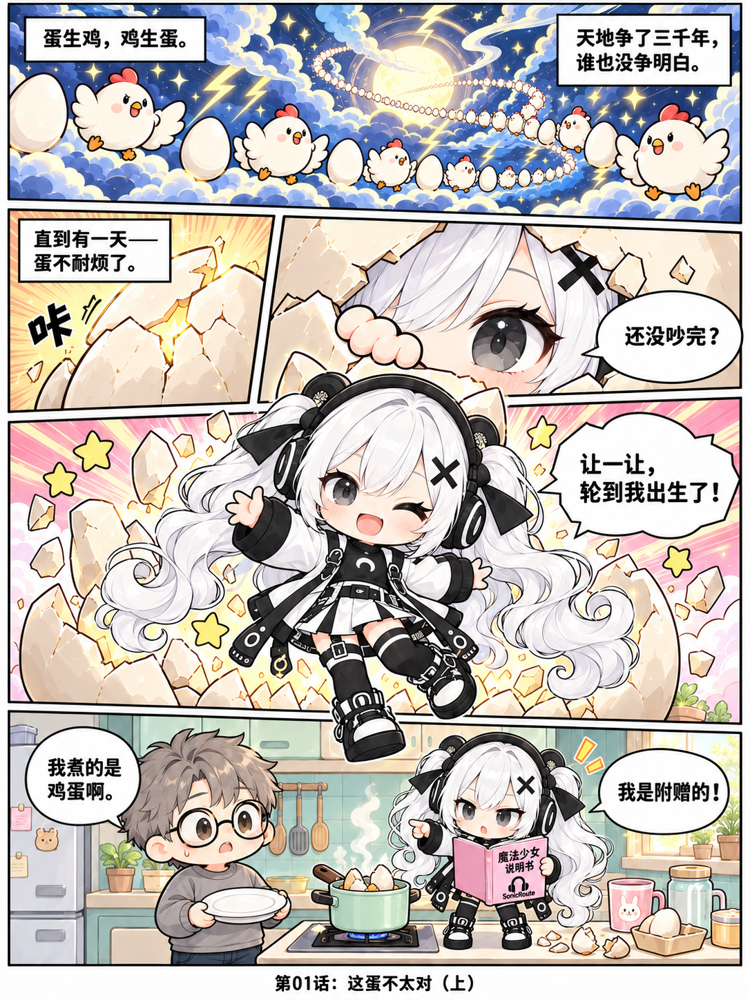

# 第01话：这蛋不太对

> [🏠 漫画首页](../../../../README.md) / [📚 小跃的奇妙日常](../../README.md) / **📖 第01话：这蛋不太对**

**📑 本话导览**：[上篇 · 破壳登场](#上篇) · [下篇 · 全屋冷静](#下篇) | ⏭️ [下一话：第02话 退货退成批发 →](../002-return-to-wholesale/README.md#上篇) · [📋 正篇目录](../../README.md#正篇连载)

---

## 上篇

*2026-10-15 发布 · 2026-10-16 更新*

> 蛋生鸡，鸡生蛋，天地争了三千年……直到今天，蛋终于不耐烦了！

🔍 **[查看未压缩原生超清原图](part-1.png)** · ⬇️ **[继续阅读下篇](#下篇)**

---

## 下篇

*2026-10-16 更新*

> 单位漏了个 c，煎蛋变成了顶穿屋顶的巨蛋；小跃施法“全屋冷静”，连灶台火苗都被冻成了实心冰块！

🔍 **[查看未压缩原生超清原图](part-2.png)** · ⬆️ **[返回上篇](#上篇)**

---

| ⏮️ 上一话 | 📋 目录导航 | ⏭️ 下一话 |
| :---: | :---: | :---: |
| *故事起点* | **[返回正篇目录](../../README.md#正篇连载)** | **[第02话：退货退成批发 →](../002-return-to-wholesale/README.md#上篇)** |

[🔝 回到顶部](#第01话这蛋不太对)

