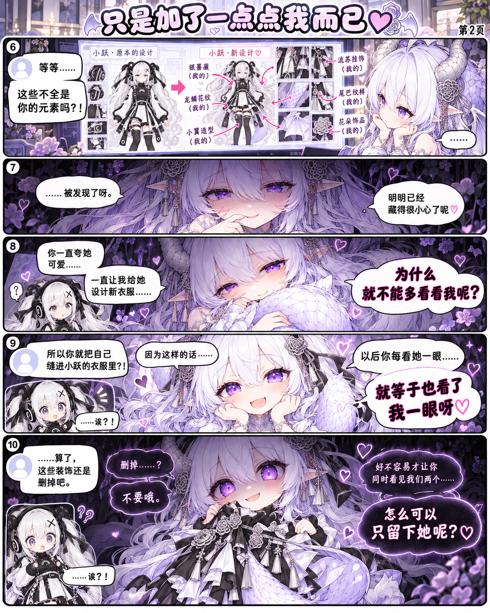
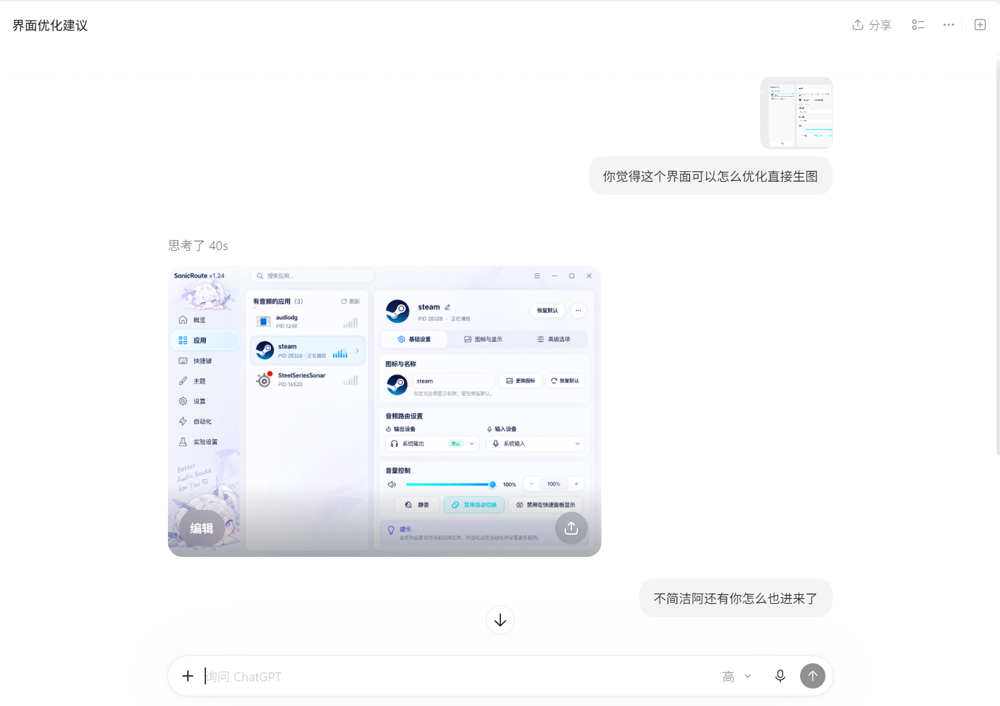

# 独立番外 Mix：只是加了一点点我而已

> [🏠 漫画首页](../../../../README.md) / [📚 小跃的奇妙日常](../../README.md) / [🎉 独立番外](../../README.md#番外) / **Mix：只是加了一点点我而已**

> 💡 **番外说明**：全2页独立番外短剧，与正篇及其他番外不共享剧情，随开随读！

**📑 本篇导览**：[第1页](#第1页) · [第2页](#第2页) · [🎨 创作原型](#创作原型) | ⏮️ [← 上一篇番外：Fab 小跃工厂](../fab-xiaoyue-factory/README.md) · [📋 番外目录](../../README.md#番外)

---

## 第1页

*2026-10-20 发布*

> 给小跃量身定制全新日常与战斗新衣时，GPT 拟人龙娘设计师悄悄加入了“亿点点”属于自己的元素……

🔍 **[查看未压缩原生超清原图](Mix-p01.png)** · ⬇️ **[继续翻到第2页](#第2页)**

---

## 第2页

*2026-10-20 发布*

> 满身龙角、鳞纹、龙翼和尾巴的小跃满头问号：“你管这叫加了一点点？！”

🔍 **[查看未压缩原生超清原图](Mix-p02.png)** · ⬆️ **[回到第1页](#第1页)**

---

## 🎨 创作原型

> 本篇番外的诞生灵感源自真实开发中的“意外产物”——在进行界面优化时意外蹦出的龙娘元素截图！

🔍 **[查看原型原图](prototype.png)**

---

| ⏮️ 上一篇独立番外 | 📋 番外目录 | 🚀 正篇连载入口 |
| :---: | :---: | :---: |
| **[← 番外 Fab：小跃工厂](../fab-xiaoyue-factory/README.md)** | **[返回番外目录](../../README.md#番外)** | **[从正篇第01话开始](../../chapters/001-this-egg-is-not-right/README.md#上篇)** |

[🔝 回到顶部](#独立番外-mix只是加了一点点我而已)

